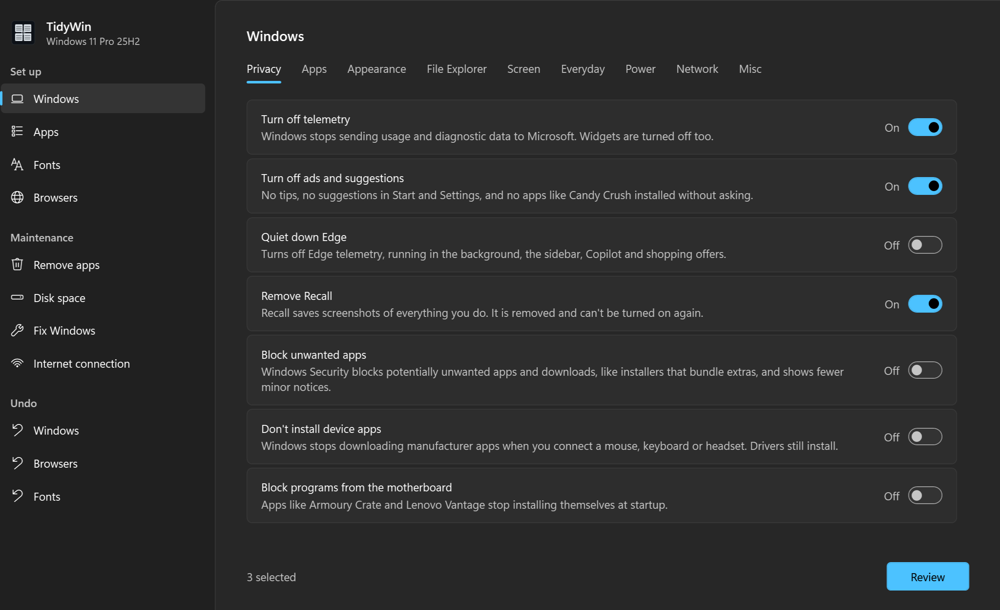

# TidyWin Windows Utility

**Set up and look after your Windows PC from one window.**

Clean up telemetry and bloat, install your apps and fonts, diagnose and fix problems, and back up your apps and drivers before formatting. Nothing changes until you pick it.

[](https://github.com/androksi/tidywin/actions/workflows/lint.yml)
[](#good-to-know)
[](LICENSE)

---



## Quick Start

Right-click the Start button, choose **Terminal** (or PowerShell) and run:

```powershell
irm androksi.github.io/tidywin/run | iex
```

It asks for administrator rights, then opens the TidyWin window: pick an option in the sidebar and its options show up right away, nothing selected. Turn on what you want, review and apply; the progress shows in the same window.

> [!TIP]
> Formatting the PC? Follow [Reinstalling Windows, step by step](docs/reinstall.md): it lists the options in the right order.

## Good to know

- Needs Windows 10 or 11 and Administrator rights (requested automatically). Windows PowerShell 5.1 comes with Windows.
- Nothing comes selected: only what you turn on is changed. Windows creates a restore point first.
- Windows Defender, Firewall, Windows Update and Safe Browsing are never touched.
- Everything can be run again safely.
- Nothing stays on the PC: the scripts are downloaded to `%TEMP%\tidywin` and deleted when TidyWin closes.

<details>
<summary>Run from a local copy</summary>

```powershell
git clone https://github.com/androksi/tidywin
cd tidywin
Set-ExecutionPolicy -Scope Process -ExecutionPolicy Bypass
.\scripts\TidyWin.ps1
```

Run as Administrator. The panel uses the scripts next to it instead of downloading them. Each script also runs on its own (for example `.\scripts\windows\Clean-Windows.ps1`); the browser and `fonts` scripts accept `-Revert`, and `windows` is undone by `Revert-Configure-Windows.ps1`.

</details>

---

[Report an issue](https://github.com/androksi/tidywin/issues) · [GPL-3.0](LICENSE), provided as is, without warranty.
