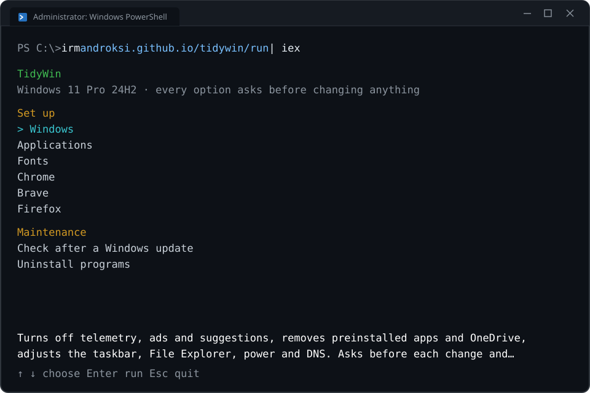

# TidyWin Windows Utility

TidyWin **removes** telemetry and preinstalled apps from Windows 10 and 11, **installs** apps with WinGet and **configures** Chrome, Brave and Firefox for privacy.

[](https://github.com/androksi/tidywin/actions/workflows/lint.yml)
[](#requirements)
[](LICENSE)

---



## Quick Start

> [!IMPORTANT]
> TidyWin makes system-wide changes and needs Administrator rights. It requests them automatically.

Open PowerShell and run one of the commands:

```powershell
irm androksi.github.io/tidywin/windows | iex
irm androksi.github.io/tidywin/apps | iex
irm androksi.github.io/tidywin/chrome | iex
irm androksi.github.io/tidywin/brave | iex
irm androksi.github.io/tidywin/firefox | iex
irm androksi.github.io/tidywin/dev | iex
```

### Undo

```powershell
irm androksi.github.io/tidywin/windows-revert | iex
irm androksi.github.io/tidywin/chrome-revert | iex
irm androksi.github.io/tidywin/brave-revert | iex
irm androksi.github.io/tidywin/firefox-revert | iex
irm androksi.github.io/tidywin/dev-revert | iex
```

### Maintenance

```powershell
irm androksi.github.io/tidywin/windows-check | iex
irm androksi.github.io/tidywin/cleanup | iex
irm androksi.github.io/tidywin/repair | iex
irm androksi.github.io/tidywin/apps-export | iex
irm androksi.github.io/tidywin/apps-import | iex
irm androksi.github.io/tidywin/wallpapers | iex
```

### How to open PowerShell

- Right-click the Start button and choose **Terminal**.
- Or press <kbd>Win</kbd> + <kbd>R</kbd>, type `powershell` and press <kbd>Enter</kbd>.

The script is downloaded to `%TEMP%\tidywin` and deleted after it runs. Each script asks for the language when it starts: English (default) or Portuguese.

## Scripts

| Command | What it does |
|---|---|
| `windows` | Telemetry, preinstalled apps, OneDrive, Edge, taskbar, File Explorer and DNS. Creates a restore point first. |
| `apps` | Pick and install from 100 apps with WinGet. |
| `chrome` | Turns off telemetry and AI features and blocks third-party cookies. |
| `brave` | Turns off Wallet, VPN, Rewards, Leo, News and telemetry. |
| `firefox` | Turns off telemetry, sponsored content and AI. Installs uBlock Origin and Bitwarden. |
| `dev` | Editors, Git, SSH key for GitHub, signed commits, Windows Terminal with a Nerd Font, languages and WSL. |
| `windows-check` | Checks whether a Windows update brought anything back and offers to reapply it. |
| `cleanup` | Frees disk space: temporary files, Windows Update downloads, error reports and more. Asks before each item. |
| `repair` | Checks and repairs system files and the disk with Windows' own tools (DISM, sfc, disk check). |
| `apps-export` / `apps-import` | Saves the list of installed apps before formatting and installs them back afterwards. |
| `wallpapers` | Pick wallpapers from a list and download them. [Preview](docs/wallpapers.md). |

Windows Defender, Windows Firewall, Windows Update and Safe Browsing are left untouched. Every script can be run more than once.

<details>
<summary>Run from a local copy</summary>

```powershell
git clone https://github.com/androksi/tidywin
cd tidywin
Set-ExecutionPolicy -Scope Process -ExecutionPolicy Bypass
.\scripts\windows\Configure-Windows.ps1
```

Run as Administrator. Browser scripts accept `-Revert`.

</details>

## Requirements

- Windows 10 or 11
- Windows PowerShell 5.1 (included with Windows)

## Resources

- [Windows options](docs/windows.md)
- [App list](docs/apps.md)
- [Browser policies](docs/browsers.md)
- [Developer setup](docs/dev.md)
- [Wallpapers](docs/wallpapers.md)
- [Changelog](CHANGELOG.md)
- [Report an issue](https://github.com/androksi/tidywin/issues)

## License

[GPL-3.0](LICENSE). Provided as is, without warranty.
